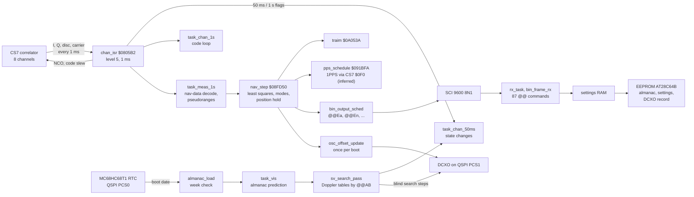

# VP Oncore firmware: overview

B4121P1115, SFTW P/N 98-P36830P VER 8 REV 8 (06 Aug 1996), from an HP
58503A.  C, built with HP B3640 A.04.10 and its CPU32 run-time
library; Motorola's own startup code.  Details and addresses:
[memory-map.md](memory-map.md), [messages.md](messages.md); Ghidra
rebuild: [tools/ghidra](../tools/ghidra/README.md).

| Part | What | Where (memory-map.md) |
|---|---|---|
| Scheduler | 26 pre-emptive tasks, request flags $8DC+, one stack from $20000 | "CS7: the tracking channels" (tasks), names-globals.tsv |
| Tracking | 1 ms interrupt, channel states 0 search ... 5 phase lock, 10 ms blocks, 2 ms pairs | "CS7: the tracking channels" |
| Search | Strategy tables per application type; almanac-aided then full sky; DCXO stepping | "CS7: the tracking channels", "Learned oscillator offset" |
| Measurements | Code phase x lambda / 256, Hatch smoothing, transmit time | "Navigation" |
| Navigation | Unweighted least squares, modes 1-6, position hold time-only, Klobuchar/Sagnac/relativity/DGPS, no troposphere | "Navigation" |
| TRAIM, 1PPS | Residual tests, one SV excluded; 9.548 MHz ticks, cable delay, offset | "Navigation" |
| Time | RTC (GPS time) at boot, fallback 01/01/<year> 12:00; almanac week window -2..+127 | "Date and time" |
| DCXO | 8-bit setting over PCS1, Hz/LSB per unit, drift target 20625 Hz at L1 | "Learned oscillator offset", "QSPI devices" |
| Host I/O | Binary @@ (87 commands), NMEA, terse ASCII, 7-bit mode 3, RTCM SC-104 input | "Host commands", "Protocol modes", messages.md |
| EEPROM | Almanac banks, settings blocks with checksums, DCXO and position records | "EEPROM layout" |
| Self-test | Channels, 1 kHz interrupt, flash sums, RAM, DCXO SPI, RTC | messages.md (Ca/Fa) |

Behaviors worth knowing:

- An unpowered RTC boots at 01/01/<EEPROM year> 12:00; the almanac is
  rejected and the search is blind until @@Ac/@@Aa or a first satellite.
- Application type Land (@@AB 2, the default) searches about 19 min per
  satellite around the almanac prediction before the full-sky search;
  Static (4, what HP's host sets) about 1.5 min.
- A floating-point error calls `trap` $0A02AA, which jumps to the reset
  entry.
- Single-stepping into `chan_isr` over BDM hangs on a CS7 write; mask
  interrupts first.
